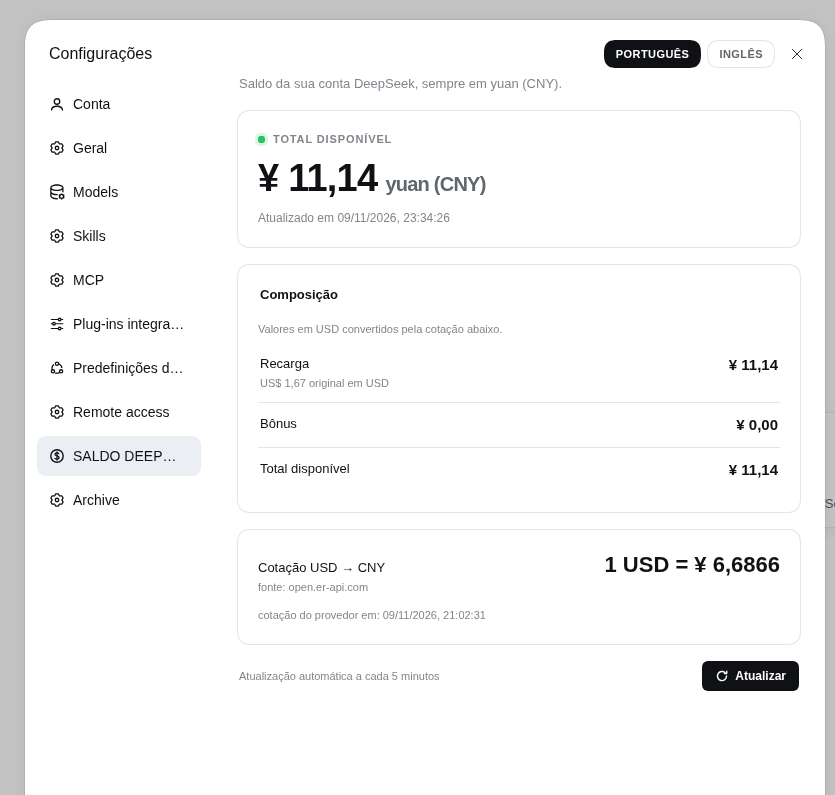
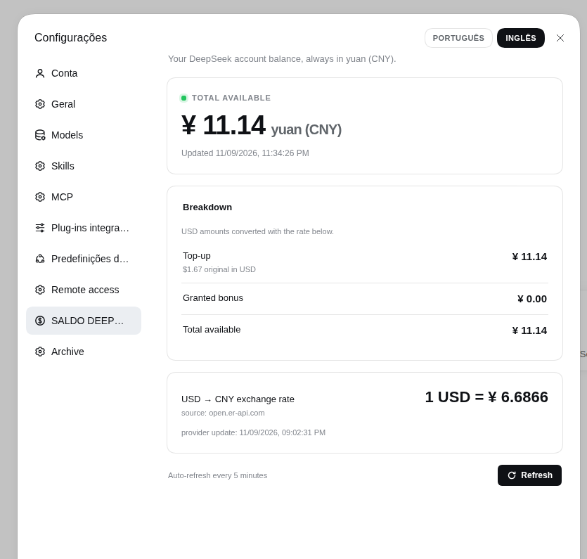
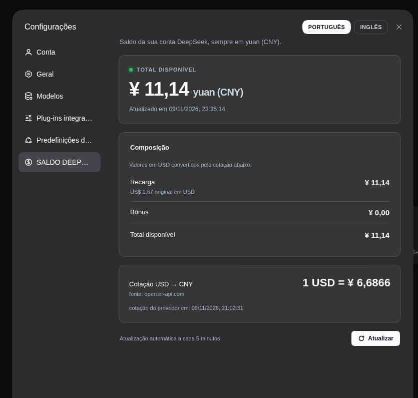

# SALDO DEEPSEEK HARNESS

> A DeepSeek Harness plugin that shows your **DeepSeek account balance in yuan (CNY)** inside **Settings**.

[](https://www.npmjs.com/package/dsh-saldo-deepseek-harness)
[](./LICENSE)
[](https://github.com/deepseek-ai/deepseek-harness)

[Português](./README.pt-BR.md) | **English**








## What it does

It adds a dedicated **SALDO DEEPSEEK HARNESS** section to the Settings dialog and answers one question in one place: *how much do I have, in yuan?*

- **Total available in CNY** as the hero number, using the daily USD→CNY rate when the account has USD wallets;
- **Top-up and granted bonus shown separately**, so recharge credit and bonus credit never blur together;
- **Original USD amounts** kept visible next to the converted values, with the rate that produced them;
- **Daily exchange rate card**: `1 USD = ¥ …`, the provider update time and the source;
- **Refresh button** that forces a fresh read (with a 2 s cooldown) plus a background auto-refresh every 5 minutes;
- **Language switch in the Settings header**: two buttons, **PORTUGUÊS / INGLÊS**. The active language is disabled, clicking the other one switches the whole page and the choice is remembered; while this section is open the buttons take the place of the global "Open configuration file" action;
- **Honest states**: not connected, rejected account, rate unavailable, stale data — each says what happened instead of showing a fake zero.

## Install

### Through the DeepSeek Harness plugin manager (recommended)

```sh
dsh plugin --profile <profile> add dsh-saldo-deepseek-harness
```

On the DSH Desktop app, open **Settings → Plugins** and install it there once it is listed in the community catalog (see [`publish/`](./publish/)). The app manages its own profile, so installing through the CLI into `profiles/web` does not reach the desktop app.

### From a local checkout

```sh
git clone https://github.com/wgrbiss-spec/dsh-saldo-deepseek-harness
dsh plugin --profile web add ./dsh-saldo-deepseek-harness
```

Restart `dsh web` (or reload the desktop app) after installing.

## Where it appears

Open **Settings** (the gear/account entry) and pick **SALDO DEEPSEEK HARNESS** in the left navigation. The section registers through the official `settings.section` slot, so it behaves like a built-in page: same panel chrome, same theme tokens, light and dark.

## Data source and privacy

| Data | Where it comes from | Where it lives |
|---|---|---|
| Balance | `GET https://platform.deepseek.com/api/v0/users/get_user_summary` with the token from the `deepseek-account-platform/default` record in `$DSH_HOME/.credentials.yaml` | Host process only |
| Exchange rate | `https://open.er-api.com/v6/latest/USD` (`rates.CNY`) | Host cache, refreshed every 6 h |

- The account token **never** reaches the browser. The host route `/saldo-deepseek-harness/summary` returns numbers and timestamps only.
- The browser only reads the host's cache (small JSON, no-store); it never talks to DeepSeek directly.
- No telemetry, no external calls beyond the two endpoints above, nothing written outside the profile's ordinary settings.
- Requires a signed-in DeepSeek account. API-key-only setups have no account wallet to read, and the page says so.

## Configuration

Override any field in your profile's `cordis.patch.yml`:

```yaml
- id: saldo-deepseek-harness
  config:
    balanceRefreshMs: 300000   # host-side balance TTL (5 min)
    rateRefreshMs: 21600000    # exchange-rate TTL (6 h)
    timeoutMs: 10000           # per-request timeout
    forceCooldownMs: 2000      # minimum gap between manual refreshes
    platformOrigin: https://platform.deepseek.com
    rateUrl: https://open.er-api.com/v6/latest/USD
```

## Requirements

- DeepSeek Harness `>=0.2.2-rc.1 <0.3.0-0` (declared as `engines.dsh`).
- A DeepSeek account connected in **Settings → Account**.

## Troubleshooting

| Symptom | Cause / fix |
|---|---|
| "Nenhuma conta DeepSeek conectada" | Sign in at **Settings → Account**; the plugin reads the stored account grant. |
| "A conta conectada foi recusada" | The stored grant was rejected (HTTP 401). Sign out and sign in again. |
| "Cotação indisponível" | The exchange-rate provider could not be reached; USD amounts are shown as `—` with the original USD value, never as a wrong yuan number. |
| Values marked "desatualizado" | The last refresh failed; the previous good value is kept and the error is shown. |
| Section does not appear | Make sure the bundle is enabled, then restart `dsh web` / reload the app. |
| Refresh does nothing | The 2 s cooldown is active, or the host cache is fresh; wait a moment. |

## Development

```sh
npm test              # unit tests for the money math
npm run validate      # package/manifest checks (also runs on prepack)
npm pack --dry-run    # inspect what gets published
```

The host half lives in [`src/index.js`](./src/index.js) (route + caches), the pure money math in [`src/summary.js`](./src/summary.js), and the browser half in [`client/client.js`](./client/client.js) (lazy-CJS bundle registering the `settings.section` page).

## Publishing to the community catalog

The full playbook (npm publish, catalog PR, validation, review notes) lives in [`publish/README.md`](./publish/README.md), with the ready-to-copy catalog entry in [`publish/`](./publish/).

## License

MIT © 2026 wgrbiss-spec
