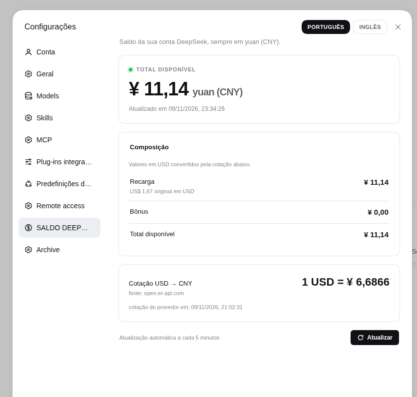
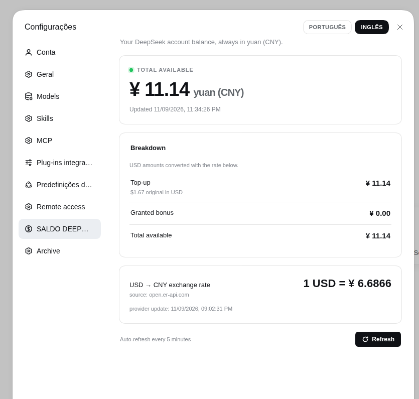
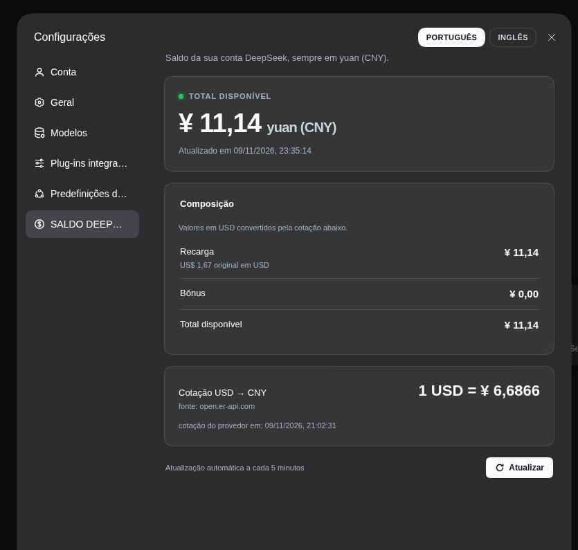

# SALDO DEEPSEEK HARNESS

> Plugin para o DeepSeek Harness que mostra o **saldo da sua conta DeepSeek em yuan (CNY)** dentro de **Configurações**.

**Português** | [English](./README.md)








## O que ele faz

Adiciona uma seção própria, **SALDO DEEPSEEK HARNESS**, ao diálogo de Configurações e responde a uma pergunta em um lugar só: *quanto eu tenho, em yuan?*

- **Total disponível em CNY** em destaque, usando a cotação USD→CNY do dia quando a conta tem carteiras em dólar;
- **Recarga e bônus concedido separados**, para não misturar saldo recarregado com saldo promocional;
- **Valores originais em USD** ao lado dos valores convertidos, junto com a cotação usada;
- **Cartão da cotação do dia**: `1 USD = ¥ …`, horário de atualização do provedor e a fonte;
- **Botão Atualizar** que força uma leitura nova (com cooldown de 2 s) e atualização automática a cada 5 minutos;
- **Alternador de idioma no cabeçalho de Configurações**: dois botões **PORTUGUÊS / INGLÊS**. O idioma ativo fica desativado, o outro troca a página inteira e a preferência é lembrada; com esta seção aberta, eles ocupam o lugar do botão global "Abra o arquivo de configuração";
- **Estados honestos**: conta desconectada, conta recusada, cotação indisponível, dados desatualizados — cada um explica o que aconteceu em vez de mostrar um zero falso.

## Instalação

### Pelo gerenciador de plugins do DeepSeek Harness (recomendado)

```sh
dsh plugin --profile <perfil> add dsh-saldo-deepseek-harness
```

No app DeepSeek Harness Desktop, abra **Configurações → Plugins** e instale por ali depois que ele estiver listado no catálogo da comunidade (veja [`publish/`](./publish/)). O app gerencia o próprio perfil; instalar pelo CLI em `profiles/web` não atinge o desktop.

### A partir do código local

```sh
git clone https://github.com/wgrbiss-spec/dsh-saldo-deepseek-harness
dsh plugin --profile web add ./dsh-saldo-deepseek-harness
```

Reinicie o `dsh web` (ou recarregue o app desktop) depois de instalar.

## Onde ele aparece

Abra **Configurações** (a entrada de engrenagem/conta) e escolha **SALDO DEEPSEEK HARNESS** na navegação da esquerda. A seção usa o slot oficial `settings.section`, então se comporta como uma página nativa: mesmo painel, mesmos tokens de tema, claro e escuro.

## Fonte dos dados e privacidade

| Dado | Origem | Onde fica |
|---|---|---|
| Saldo | `GET https://platform.deepseek.com/api/v0/users/get_user_summary` com o token do registro `deepseek-account-platform/default` em `$DSH_HOME/.credentials.yaml` | Somente no processo host |
| Cotação | `https://open.er-api.com/v6/latest/USD` (`rates.CNY`) | Cache do host, renovado a cada 6 h |

- O token da conta **nunca** chega ao navegador. A rota `/saldo-deepseek-harness/summary` devolve apenas números e horários.
- O navegador só lê o cache do host (JSON minúsculo, `no-store`); nunca fala com a DeepSeek diretamente.
- Sem telemetria, sem chamadas além dos dois endpoints acima, nada gravado fora das configurações normais do perfil.
- Requer uma conta DeepSeek conectada. Instalações só com API key não têm carteira de conta para ler, e a página informa isso.

## Configuração

Sobrescreva qualquer campo no `cordis.patch.yml` do perfil:

```yaml
- id: saldo-deepseek-harness
  config:
    balanceRefreshMs: 300000   # TTL do saldo no host (5 min)
    rateRefreshMs: 21600000    # TTL da cotação (6 h)
    timeoutMs: 10000           # timeout por requisição
    forceCooldownMs: 2000      # intervalo mínimo entre atualizações manuais
    platformOrigin: https://platform.deepseek.com
    rateUrl: https://open.er-api.com/v6/latest/USD
```

## Requisitos

- DeepSeek Harness `>=0.2.2-rc.1 <0.3.0-0` (declarado em `engines.dsh`).
- Uma conta DeepSeek conectada em **Configurações → Conta**.

## Solução de problemas

| Sintoma | Causa / solução |
|---|---|
| "Nenhuma conta DeepSeek conectada" | Entre em **Configurações → Conta**; o plugin lê o grant armazenado. |
| "A conta conectada foi recusada" | O grant foi rejeitado (HTTP 401). Saia e entre novamente. |
| "Cotação indisponível" | O provedor de câmbio não respondeu; valores em USD aparecem como `—` com o valor original em USD, nunca como um yuan errado. |
| Valores marcados "desatualizado" | A última atualização falhou; o último valor bom é mantido e o erro é exibido. |
| A seção não aparece | Confirme que o bundle está habilitado e reinicie `dsh web` / recarregue o app. |
| Atualizar não faz nada | O cooldown de 2 s está ativo ou o cache do host está fresco; aguarde um instante. |

## Desenvolvimento

```sh
npm test              # testes unitários da matemática do saldo
npm run validate      # checagens de pacote/manifesto (também roda no prepack)
npm pack --dry-run    # inspeciona o que será publicado
```

A metade host fica em [`src/index.js`](./src/index.js) (rota + caches), a matemática pura em [`src/summary.js`](./src/summary.js) e a metade do navegador em [`client/client.js`](./client/client.js) (bundle lazy-CJS que registra a página `settings.section`).

## Publicação no catálogo da comunidade

O passo a passo completo (npm publish, PR no catálogo, validação, notas de revisão) está em [`publish/README.md`](./publish/README.md), com a entrada pronta para copiar em [`publish/`](./publish/).

## Licença

MIT © 2026 wgrbiss-spec
